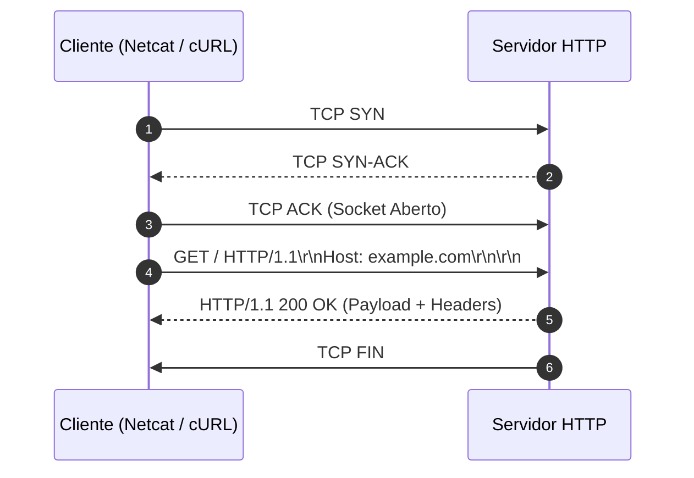

[Voltar ao Início](../index.html)
# Memória de Desenvolvimento — Semana 01: Protocolo HTTP & Sockets Bare-Metal

**Aluno:** Rafael Monteiro Viana  
**Matrícula:** 202421200307  
**Curso:** Sistemas de Informação

---

## 1. Mapeamento da Camada de Transporte

Diagrama Mermaid demonstrando o ciclo de vida da requisição executada no laboratório:

---

## 2. Registro dos Experimentos de Laboratório

### Experimento 1: Netcat Nu & Falha 400 Bad Request

- **Comando Testado:** `nc -C example.com 80` sem o header `Host:`
- **Resultado:** O código retornado foi "400 Bad Request", no HTTP/1.1 o cabeçalho Host é obrigatório pois ele informa qual domínio o cliente deseja acessar

### Experimento 2: Semântica dos Métodos HTTP

- **Análise dos Verbos:** O `GET` é usado para recuperar um recurso, o `POST` para enviar dados para o servidor e `OPTIONS` para consultar quais são as opções de comunicação disponíveis.
- **Header Content-Length:** Informa o tamanho do corpo da mensagem, em bytes. Em HTTP/1.1, isso ajuda o receptor a identificar quanto conteúdo precisa ler; a mensagem também pode usar outras formas de delimitação, como transferência em blocos (chunked).

### Experimento 3: URL, Query Strings & Percent-Encoding

- **URL Testada: (Passo 1)** curl -v http://httpbin.org/get?curso=Engenharia da Computacao
- **URL Testada: (Passo 2)** curl -v https://httpbin.org/get?curso=Engenharia%20da%20Computa%C3%A7%C3%A3o
- **O erro no Passo 1:** No meu terminal não foi retornado um erro, mas acredito que tenha sido porque o terminal identificou os espaços reais como separadores, então foi retornado o curso de Engenharia.
- **A função do `%20`:** A internet foi projetada originalmente para entender apenas o alfabeto inglês padrão e alguns símbolos básicos, nesse caso existem esses códigos para substituir certos caracteres para que navegadores e servidores consigam reconhecer de forma estável e segura.

### Experimento 4: Negociação de Conteúdo & User-Agent

- **Análise:** O cabeçalho Accept informa quais tipos de conteúdo o cliente prefere receber. Já o User-Agent identifica o cliente de forma descritiva. O servidor pode usar essas informações para selecionar uma representação, adaptar a resposta ou registrar estatísticas.

### Experimento 5: Redirecionamentos & Cache Condicional

- **Redirecionamento (301):** -I solicita apenas os cabeçalhos da resposta. Sem -L, o curl mostra a resposta do redirecionamento, normalmente com status 301 e um cabeçalho Location. Com -L, o curl segue o endereço indicado e mostra também a resposta do destino. Como o destino pode variar, você poderá observar mais de um bloco de cabeçalhos.
- **Validação de Cache (304):** a ETag funciona como um identificador de uma versão do recurso. O cliente envia esse identificador em If-None-Match; se a versão não mudou, o servidor pode responder 304, economizando largura de banda e evitando a retransmissão do conteúdo.

---

## 3. Conclusão Técnica

A comunicação HTTP na camada de aplicação depende da transmissão correta de bytes e da interpretação dos dados conforme o protocolo. Em HTTP/1.1, os cabeçalhos são delimitados por sequências CRLF (\r\n), e uma linha vazia separa os cabeçalhos do corpo da mensagem. Compreender essa estrutura permite construir requisições válidas, interpretar respostas e diagnosticar erros de comunicação.

Esses conceitos são importantes para o desenvolvimento de sistemas distribuídos e de alta performance porque a comunicação ocorre por meio de fluxos de bytes, que podem ser recebidos em partes e precisam ser interpretados corretamente. O conhecimento sobre métodos HTTP, tamanho do corpo, codificação de URLs, negociação de conteúdo, redirecionamentos e cache condicional ajuda a reduzir falhas, tráfego desnecessário e processamento redundante.
